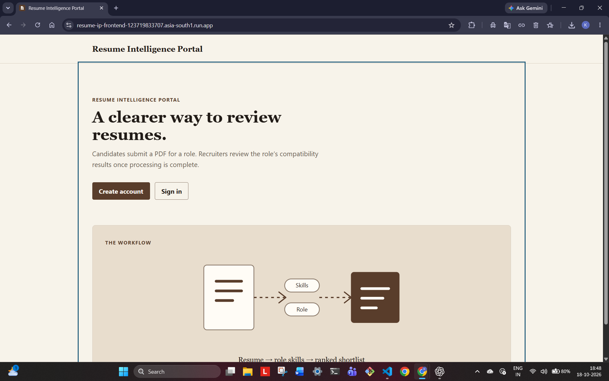
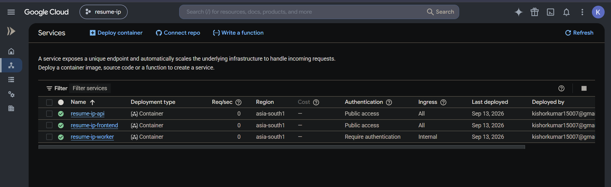
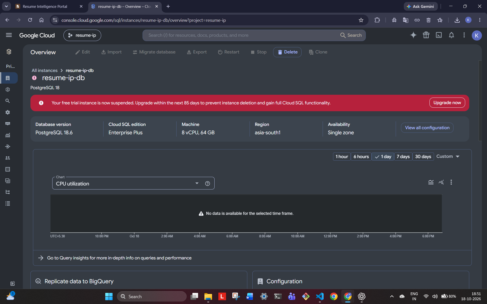
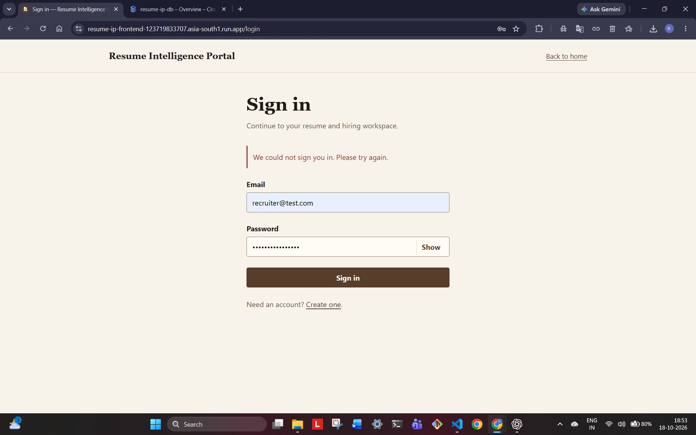

# Resume Intelligence Portal — DA3 Report

| Field | Value |
| --- | --- |
| Name | To be filled before final submission |
| Registration number | To be filled before final submission |
| Course | BACSE344 |
| Slot | C1 |
| Assignment | DA3 |
| GitHub branch link | Add the accessible `assignment-3` branch URL before final submission |

## Section 0: Application and environment

The Resume Intelligence Portal allows recruiters to create job postings with required skills and candidates to submit PDF resumes. The application has a React/Vite frontend, a FastAPI API, and a separate resume-processing worker. The worker processes submitted resumes and calculates a rule-based skill-match score for recruiters to review. The existing DA1 system is the baseline for DA3; its pre-existing features are not presented as newly implemented DA3 work.

### DA1 hosting and live status

The DA1 frontend URL is [https://resume-ip-frontend-123719832707.asia-south1.run.app/](https://resume-ip-frontend-123719832707.asia-south1.run.app/). On 18 October 2026, the landing page loaded in the browser, establishing that the frontend URL was reachable at the time of capture (Figure 0.1).

The Google Cloud Console for project `resume-ip` listed three Cloud Run services in region `asia-south1`: `resume-ip-api`, `resume-ip-frontend`, and `resume-ip-worker`. The service list showed green status/check icons for all three at the time of capture. The API and frontend were listed with public access and ingress set to `All`; the worker was listed as requiring authentication with internal ingress. The console showed a last-deployed date of 13 September 2026 for these services (Figure 0.2). This is evidence of the service-list status shown by Cloud Run, not an end-to-end test of all application functions.

**Figure 0.1. DA1 frontend URL reachable in a browser.**

**Figure 0.2. Cloud Run service list for the DA1 application.**

### Cloud SQL status and database-dependent behaviour

The DA1 database instance is identified in the Google Cloud Console as `resume-ip-db`, running Cloud SQL for PostgreSQL 18.6 in `asia-south1`. On 18 October 2026, its overview displayed the explicit warning: “Your free trial instance is now suspended,” and stated that an upgrade was required within the next 85 days to prevent instance deletion and regain full Cloud SQL functionality (Figure 0.3). The owner reports that the one-month Cloud SQL trial expired. This console message confirms that the instance was suspended when the screenshot was taken; the report does not claim that the database was deleted.

A sign-in attempt at the frontend's `/login` page displayed “We could not sign you in. Please try again.” (Figure 0.4). The screenshot confirms the user-visible sign-in failure, but does not show the HTTP status code or backend exception. Given the suspended Cloud SQL instance and the application's database dependency, the failure is consistent with the database being unavailable; the screenshot alone does not prove the precise backend cause.

**Figure 0.3. Cloud SQL reports that the DA1 free-trial instance is suspended.**

**Figure 0.4. The sign-in page displays a generic failure message.**

### DA3 environment decision

The DA3 plan is to use Neon PostgreSQL for the DA3 database-backed work and controlled load-test experiments. At the time of this baseline capture, migration to Neon has **not** yet been completed. No claim is made here that DA1 data has been migrated from Cloud SQL to Neon. The intended DA3 configuration, migrations and smoke tests belong to Phase 1.

| Item | Observed state | Evidence / verification |
| --- | --- | --- |
| DA1 frontend | Browser loaded the frontend landing page | `evidence/env-da1-url-reachable.png` |
| Hosting platform | Cloud Run services listed in `asia-south1` | `evidence/env-da1-deployment-status.png` |
| API service | `resume-ip-api`; green status/check icon in service list; public access listed | `evidence/env-da1-deployment-status.png` |
| Frontend service | `resume-ip-frontend`; green status/check icon in service list; public access listed | `evidence/env-da1-deployment-status.png` |
| Worker service | `resume-ip-worker`; green status/check icon in service list; authentication required and internal ingress listed | `evidence/env-da1-deployment-status.png` |
| DA1 database | `resume-ip-db`, Cloud SQL PostgreSQL 18.6, `asia-south1`; trial instance explicitly reported as suspended | `evidence/env-cloudsql-suspended.png` |
| Database-dependent sign-in | UI displayed a generic sign-in failure; HTTP status/backend exception not captured | `evidence/env-db-dependent-login-error.png` |
| DA3 database | Neon PostgreSQL is planned; migration is pending | Verify after Phase 1, Steps 3–4 |
| Baseline Git branch | `main`; DA3 branch created as `assignment-3` | Verify current commit hashes with `git log` before final submission |

The branch `assignment-3` was created from `main` during Phase 0 Step 1. The last recorded repository state had `main` at commit `07370d1` (`Ready for use`); verify this against the current local Git history before final submission. The report cover's name, registration number and final accessible GitHub branch URL will be filled before the final submission export.

### Step 3 — Neon configuration

The owner confirms Neon project `resume-ip-da3`, PostgreSQL 18, AWS Asia Pacific 1 (Singapore), database `neondb`, and default branch `production`. The captured Neon branch overview verifies the project name, Singapore region, and default `production` branch. It does not visibly show the PostgreSQL version; PostgreSQL 18 is owner-confirmed rather than independently visualised. Per the Step 3 evidence decision, no supplementary version screenshot is required. The protected external environment values were not inspected.

The backend configuration reserves pooled `DATABASE_URL` for application runtime traffic and direct `MIGRATION_DATABASE_URL` for Alembic. The separation is necessary because Neon uses transaction pooling at the pooled endpoint, which is unsuitable for the intended migration workflow. Both Neon URLs must use `sslmode=require`.

The SQLAlchemy runtime engine uses `pool_pre_ping=True`, `pool_recycle=300`, `DB_POOL_SIZE=5`, and `DB_MAX_OVERFLOW=5`. Ten possible connections per backend process is a configuration ceiling, not evidence that three processes can use thirty connections within the Neon plan. Static source and ConfigParser escaping checks passed; Neon migration, database connectivity, API smoke testing, and the effective three-instance connection budget remain unverified.

## 1a — Scale setup and distribution

**Requirement:** Describe your peak-demand situation and the API that will be hit hardest. Then run three instances of your backend using Docker Compose behind an Nginx load balancer, connected to your existing cloud database. Show that requests are distributed across all three instances. (1 mark)

**What I built:** TODO(evidence)

**Commands run:** TODO(evidence)

**Result:** TODO(evidence)

**Evidence:** TODO(evidence)

**Explanation:** TODO(evidence)

**Honesty notes:** TODO(evidence)

## 1b — One versus three backend instances

**Requirement:** Using Apache Bench or any suitable free load-testing tool (for example, hey, JMeter or k6), send 1,000 requests to that API, first with 1 instance and then with 3 instances, keeping the same tool and concurrency level for both runs. Tabulate requests per second and average response time, and state the improvement. (1.5 marks)

**What I built:** TODO(evidence)

**Commands run:** TODO(evidence)

**Result:** TODO(evidence)

**Evidence:** TODO(evidence)

**Explanation:** TODO(evidence)

**Honesty notes:** TODO(evidence)

## 1c — Backend failure resilience

**Requirement:** Stop one instance while the load test is running and record the failed requests. Then configure Nginx so that no request fails, and show the before-and-after count. (1.5 marks)

**What I built:** TODO(evidence)

**Commands run:** TODO(evidence)

**Result:** TODO(evidence)

**Evidence:** TODO(evidence)

**Explanation:** TODO(evidence)

**Honesty notes:** TODO(evidence)

## 1d — Architecture and cloud bursting/edge/fog

**Requirement:** Draw the architecture diagram of your own implementation, using the actual names of your components: your frontend, the three backend containers and Nginx from part (a) (with their ports), your cloud database and hosting platform from Assignment 1, and the tools used (e.g., MongoDB Atlas, Render, Firebase). Then add the cloud bursting or edge/fog computing component to the same diagram, marked in a different colour, and explain how it would handle your peak-demand situation from part (a), and why you chose it for your domain. (1 mark)

**What I built:** TODO(evidence)

**Commands run:** TODO(evidence)

**Result:** TODO(evidence)

**Evidence:** TODO(evidence)

**Explanation:** TODO(evidence)

**Honesty notes:** TODO(evidence)

## 2a — Sensitive data and password hashing

**Requirement:** Identify the most sensitive data your application stores (for example, patient records, student marks, or employee/production data). Store user passwords as salted hashes (bcrypt or Argon2) instead of plain text, and show a database screenshot before and after. (1 mark)

**What I built:** Existing DA1 baseline: Argon2 password hashing exists in `backend/app/core/security.py`; this baseline implementation is not by itself DA3 evidence. TODO(evidence)

**Commands run:** TODO(evidence)

**Result:** TODO(evidence)

**Evidence:** TODO(evidence)

**Explanation:** TODO(evidence)

**Honesty notes:** TODO(evidence)

## 2b — MFA and update/delete authorization

**Requirement:** Add multi-factor authentication to login using a TOTP authenticator app (Google or Microsoft Authenticator). Restrict your Update and Delete APIs to logged-in users with the right role for your domain (for example, doctor, faculty, or supervisor), and show a request being rejected without a valid token. (1.5 marks)

**What I built:** Existing DA1 baseline: recruiter role and posting-owner checks exist for update/delete in `backend/app/routers/postings.py`; TOTP MFA has not yet been implemented. TODO(evidence)

**Commands run:** TODO(evidence)

**Result:** TODO(evidence)

**Evidence:** TODO(evidence)

**Explanation:** TODO(evidence)

**Honesty notes:** TODO(evidence)

## 2c — Trivy scan and image hardening

**Requirement:** Scan your application's Docker image with Trivy. Harden it (smaller base image, non-root user), rescan, and tabulate the CRITICAL and HIGH counts before and after. (1.5 marks)

**What I built:** Existing DA1 baseline: `backend/Dockerfile` uses a slim base and an unprivileged user; no DA3 baseline/rescan evidence has been collected yet. TODO(evidence)

**Commands run:** TODO(evidence)

**Result:** TODO(evidence)

**Evidence:** TODO(evidence)

**Explanation:** TODO(evidence)

**Honesty notes:** TODO(evidence)

## 2d — Threat agents and regulation

**Requirement:** Name two threat agents relevant to your domain. For each, state the control you implemented against it and one requirement from the regulation that applies to your application (HIPAA for health data, GDPR for personal data in general), with a reason why that regulation applies. (1 mark)

**What I built:** TODO(evidence)

**Commands run:** TODO(evidence)

**Result:** TODO(evidence)

**Evidence:** TODO(evidence)

**Explanation:** TODO(evidence)

**Honesty notes:** TODO(evidence)

## Reproduction

TODO(evidence)

## Limitations and honesty notes

- The environment screenshots show the state observed on 18 October 2026; cloud service status can change.
- The Cloud Run service list and a loaded frontend page do not prove that all backend/database-dependent features work.
- The login screenshot establishes a generic UI failure only. It does not expose an HTTP status code or establish the exact exception.
- The Cloud SQL console explicitly reports the trial instance as suspended. Neon migration and its smoke tests are still pending.
- All performance, failover and security-scan results remain pending until measured and captured.

TODO(evidence)

## Evidence index

See [`04-evidence-index.md`](04-evidence-index.md). Phase 0 environment screenshots are embedded in Section 0 and listed in the evidence index. TODO(evidence)
