# Resume Intelligence Portal — DA3 Report

| Field | Value |
| --- | --- |
| Name | Kishor Kumar |
| Registration number | To be filled before final submission |
| Course | BACSE344 |
| Slot | C1 |
| Assignment | DA3 |
| GitHub branch link | `https://github.com/KishorKumar15007/resume-ip/tree/assignment-3` (accessibility/push status unverified) |

## Section 0: Application and environment

The Resume Intelligence Portal allows recruiters to create job postings with required skills and candidates to submit PDF resumes. The application has a React/Vite frontend, a FastAPI API, and a separate resume-processing worker. The worker processes submitted resumes and calculates a rule-based skill-match score for recruiters to review. The existing DA1 system is the baseline for DA3; its pre-existing features are not presented as newly implemented DA3 work.

### DA1 hosting and live status

The DA1 frontend URL is [https://resume-ip-frontend-123719832707.asia-south1.run.app/](https://resume-ip-frontend-123719832707.asia-south1.run.app/). On 18 October 2026, the landing page loaded in the browser, establishing that the frontend URL was reachable at the time of capture (Figure 0.1).

The Google Cloud Console for project `resume-ip` listed three Cloud Run services in region `asia-south1`: `resume-ip-api`, `resume-ip-frontend`, and `resume-ip-worker`. The service list showed green status/check icons for all three at the time of capture. The API and frontend were listed with public access and ingress set to `All`; the worker was listed as requiring authentication with internal ingress. The console showed a last-deployed date of 13 September 2026 for these services (Figure 0.2). This is evidence of the service-list status shown by Cloud Run, not an end-to-end test of all application functions.

**Figure 0.1. DA1 frontend URL reachable in a browser.**


**Figure 0.2. Cloud Run service list for the DA1 application.**


### Cloud SQL status and database-dependent behaviour

The DA1 database instance is identified in the Google Cloud Console as `resume-ip-db`, running Cloud SQL for PostgreSQL 18.6 in `asia-south1`. On 18 October 2026, its overview displayed the explicit warning: “Your free trial instance is now suspended,” and stated that an upgrade was required within the next 85 days to prevent instance deletion and regain full Cloud SQL functionality (Figure 0.3). The owner reports that the one-month Cloud SQL trial expired. This console message confirms that the instance was suspended when the screenshot was taken; the report does not claim that the database was deleted.

A sign-in attempt at the frontend's `/login` page displayed “We could not sign you in. Please try again.” (Figure 0.4). The screenshot confirms the user-visible sign-in failure, but does not show the HTTP status code or backend exception. Given the suspended Cloud SQL instance and the application's database dependency, the failure is consistent with the database being unavailable; the screenshot alone does not prove the precise backend cause.

**Figure 0.3. Cloud SQL reports that the DA1 free-trial instance is suspended.**


**Figure 0.4. The sign-in page displays a generic failure message.**


### DA3 environment decision

The DA3 database-backed work uses Neon PostgreSQL. The DA1 Cloud SQL data was not carried over: the migrated Neon schema and smoke-test records are test data only. The Neon migration and API smoke test are documented below. The owner confirmed that the separate `da3-loadtest` Neon branch for later scale experiments was created from the actual default branch, `production`.

| Item | Observed state | Evidence / verification |
| --- | --- | --- |
| DA1 frontend | Browser loaded the frontend landing page | `evidence/env-da1-url-reachable.png` |
| Hosting platform | Cloud Run services listed in `asia-south1` | `evidence/env-da1-deployment-status.png` |
| API service | `resume-ip-api`; green status/check icon in service list; public access listed | `evidence/env-da1-deployment-status.png` |
| Frontend service | `resume-ip-frontend`; green status/check icon in service list; public access listed | `evidence/env-da1-deployment-status.png` |
| Worker service | `resume-ip-worker`; green status/check icon in service list; authentication required and internal ingress listed | `evidence/env-da1-deployment-status.png` |
| DA1 database | `resume-ip-db`, Cloud SQL PostgreSQL 18.6, `asia-south1`; trial instance explicitly reported as suspended | `evidence/env-cloudsql-suspended.png` |
| Database-dependent sign-in | UI displayed a generic sign-in failure; HTTP status/backend exception not captured | `evidence/env-db-dependent-login-error.png` |
| DA3 database | Neon PostgreSQL schema applied; `alembic current` reported `ce1c22c4205c (head)` | `evidence/env-alembic-head.png` |
| Baseline Git branch | `main`; DA3 branch created as `assignment-3` | Verify current commit hashes with `git log` before final submission |

The branch `assignment-3` was created from `main` during Phase 0 Step 1. The last recorded repository state had `main` at commit `07370d1` (`Ready for use`); verify this against the current local Git history before final submission. The report cover's registration number remains to be filled, and the final GitHub branch accessibility remains to be verified before the final submission export.

### Step 3 — Neon configuration

The owner confirms Neon project `resume-ip-da3`, PostgreSQL 18, AWS Asia Pacific 1 (Singapore), database `neondb`, and default branch `production`. The captured Neon branch overview verifies the project name, Singapore region, and default `production` branch. It does not visibly show the PostgreSQL version; PostgreSQL 18 is owner-confirmed rather than independently visualised. Per the Step 3 evidence decision, no supplementary version screenshot is required. The protected external environment values were not inspected.

The backend configuration reserves pooled `DATABASE_URL` for application runtime traffic and direct `MIGRATION_DATABASE_URL` for Alembic. The separation is necessary because Neon uses transaction pooling at the pooled endpoint, which is unsuitable for the intended migration workflow. Both Neon URLs must use `sslmode=require`.

The SQLAlchemy runtime engine uses `pool_pre_ping=True`, `pool_recycle=300`, `DB_POOL_SIZE=5`, and `DB_MAX_OVERFLOW=5`. Ten possible connections per backend process is a configuration ceiling, not evidence that three processes can use thirty connections within the Neon plan. Static source and ConfigParser escaping checks passed. The migration, table presence, and API smoke test are evidenced below; the effective three-instance connection budget remains unverified.

#### Migrations note

The following commands were run manually against the configured Neon database. The recorded terminal output shows `alembic current` at `ce1c22c4205c (head)`.

```powershell
Set-Location backend
alembic upgrade head
alembic current
```

The recorded Neon tables view lists `alembic_version`, `users`, `job_postings`, and `submissions` in `evidence/env-neon-tables.png`.

### Step 4 — Neon migration and API smoke test

The schema was applied to Neon with `alembic upgrade head`; the subsequent `alembic current` output reports revision `ce1c22c4205c (head)`. The generated smoke-test outputs in `results/04-smoke.md` and `results/04-smoke.json` agree: all 19 of 19 checks passed against `http://localhost:8000`. The test uses synthetic recruiter and candidate accounts and a synthetic posting only.

**Table 0.1. Step 4 synthetic API smoke test results (generated in `results/04-smoke.md`).**

| step | expected | actual |
| --- | --- | --- |
| Register synthetic recruiter | HTTP 201 | HTTP 201 |
| Register synthetic candidate | HTTP 201 | HTTP 201 |
| Log in synthetic recruiter | HTTP 200 and access token | HTTP 200 |
| Validate recruiter login token | non-empty access token | access token received and retained only in memory |
| Log in synthetic candidate | HTTP 200 and access token | HTTP 200 |
| Validate candidate login token | non-empty access token | access token received and retained only in memory |
| Recruiter creates posting | HTTP 201 and posting id | HTTP 201 |
| Validate created posting | non-empty posting id | posting id received |
| Recruiter reads posting | HTTP 200 with matching id | HTTP 200 |
| Validate recruiter read response | response id matches created posting | id matched |
| Candidate reads posting | HTTP 200 with matching id | HTTP 200 |
| Validate candidate read response | response id matches created posting | id matched |
| Candidate create posting is rejected | HTTP 403 | HTTP 403 |
| Candidate update posting is rejected | HTTP 403 | HTTP 403 |
| Candidate delete posting is rejected | HTTP 403 | HTTP 403 |
| Recruiter updates posting | HTTP 200 with updated title | HTTP 200 |
| Validate recruiter update response | response title matches update | title matched |
| Recruiter deletes posting | HTTP 204 | HTTP 204 |
| Deleted posting is not found | HTTP 404 | HTTP 404 |

The result capture is `evidence/env-smoke-pass.png`. The Alembic capture includes `Get-Date`, the migration commands, and the reported head revision. The owner confirmed `da3-loadtest` was created from `production`. The effective three-instance connection budget remains unverified.

### Step 6 — Hosting reconciliation

Assignment 1's application remains hosted on Google Cloud Run. Because Cloud SQL was suspended, Step 6 reconfigured the existing `resume-ip-api` service to use the pooled Neon `production` database through Secret Manager version `1`; revision `resume-ip-api-00007-676` became Ready, and the owner confirmed that synthetic database-backed CRUD worked. The frontend and worker were left unchanged, and upload, Pub/Sub delivery, and scoring were not verified in this step.

The recorded verification is in `results/06-hosting-verification.md`. The available Step 6 evidence is `evidence/env-cloudrun-api-before.png`, `evidence/env-neon-production-migration-head.png`, `evidence/env-cloudrun-service.png`, and `evidence/env-deployed-url-works.png`. The migration screenshot visibly reports the head revision; the Neon `production` target and CRUD outcome are owner-confirmed. Step 14's architecture diagram and explanation remain pending, so this reconciliation does not complete Part 1d.

## 1a — Scale setup and distribution

**Requirement:** Describe your peak-demand situation and the API that will be hit hardest. Then run three instances of your backend using Docker Compose behind an Nginx load balancer, connected to your existing cloud database. Show that requests are distributed across all three instances. (1 mark)

**What I built:** Step 7 provides the scenario, instance/response instrumentation, deterministic load-test fixtures, and generated request-mix result table for the later scale experiments. `backend/app/main.py` supplies an instance identity, `X-Served-By`, JSON access records, and `/health/db`; `docs/da3/scripts/seed_loadtest.py` creates only deterministic synthetic fixture records for the `da3-loadtest` configuration. Step 8 adds the isolated `compose.da3.yml` topology with three backend services behind Nginx, one-backend and three-backend Nginx configurations, a profile-gated Apache Bench image, Python-standard-library health checks, and an ignored raw Nginx-log mount.

**Commands run:** The preserved request checks are in `results/07-local-api-checks.txt` and the saved runtime output is `results/07-local-api-runtime.log`. The first and second fixture-seed results are in `results/07-seed-summary-first-run.*` and `results/07-seed-summary-second-run.*`. The raw artifacts preserve the endpoint checks and outcomes, but not a complete server-start command transcript. For Step 8, the owner ran the isolated Compose topology, direct and Nginx health checks, the one-backend configuration check, Nginx syntax checks, and five Nginx-recreation verification cycles. `results/08-nginx-access-excerpt.txt` preserves six real JSON access records from the recreation-5 immediate batch; the complete generated raw Nginx log remains ignored.

**Result:**

Peak-demand situation: On a placement-drive morning, assume 2,000 students access the resume portal during a 10-minute window as a major recruiter opens applications. Students log in, repeatedly browse job postings, check submission status, and submit resumes. This creates a short peak rather than steady traffic.

**Table 1a.1. Request-mix assumptions, not observations (generated in `results/07-request-mix-table.md`).**

| method | path | category | per student | total requests | share of total | average requests/s |
| --- | --- | --- | ---: | ---: | ---: | ---: |
| POST | `/auth/login` | write | 1 | 2000 | 4.55% | 3.33 |
| GET | `/postings` | read | 15 | 30000 | 68.18% | 50.00 |
| GET | `/submissions/{submission_id}` | read | 5 | 10000 | 22.73% | 16.67 |
| POST | `/postings/{posting_id}/submissions` | write | 1 | 2000 | 4.55% | 3.33 |

- Students: 2,000 (assumption)
- Peak window: 600 seconds (assumption)
- Read requests: 40,000 (assumption)
- Total HTTP requests: 44,000 (assumption)
- Average total request rate: 73.33 requests/s (assumption)
- Shares and rates use `ROUND_HALF_UP` to two decimal places.

`GET /postings` is the initial hardest-hit API by assumed request volume: 30,000 of 44,000 assumed requests (68.18%). Login occurs once per student, but Argon2 password verification may be more CPU-intensive per request. Step 10 therefore calibrates `GET /postings`; it does not compare CPU cost across endpoints and cannot independently establish which route consumes the most CPU.

The local instrumentation checks recorded `GET /health` as HTTP 200 with instance identity and `X-Served-By`; unauthenticated `GET /postings` as HTTP 401 with `X-Served-By`; an unknown path as HTTP 404 with `X-Served-By`; and `GET /health/db` as HTTP 200 with `db: ok`. The saved access-log records contain `instance`, `method`, `path`, `status`, and numeric `duration_ms` values.

The first seed run created 3 recruiters, 2 candidates, and 50 postings. The preserved second run created 0 recruiters, 0 candidates, and 0 postings, while finding 3 recruiters, 2 candidates, and 50 postings already present. The second-run summary therefore verifies idempotency for these deterministic fixtures without duplicate creation.

### Step 8 — isolated Compose and Nginx verification

The default isolated Compose topology started `backend-1`, `backend-2`, `backend-3`, and `nginx`; the profile-gated `loadtest` service was not part of that default topology. Each backend listens internally on port 8000 and maps respectively to host ports 8001, 8002, and 8003. The observed container limits were 0.5 CPU and 512 MiB for each backend. All three containers became healthy without GCP credentials or credential mounts, and no shared upload volume is configured because Step 5 is deliberately skipped. The non-secret GCS/Pub/Sub setting names remain configuration requirements, but the upload and worker paths were not exercised.

**Table 1a.2. Step 8 topology and owner-run verification.**

| Check | Verified result | Evidence / source |
| --- | --- | --- |
| Default topology | Three healthy backend containers plus Nginx; the unrelated exited `resume-portal-postgres` container was left untouched and is not part of this topology. | `evidence/1a-compose-ps.png` |
| Backend ports and identities | `backend-1`: host 8001 → container 8000; `backend-2`: 8002 → 8000; `backend-3`: 8003 → 8000. | `evidence/1a-compose-ps.png`; Compose configuration |
| Resource limits | Each backend was inspected at 0.5 CPU (`500000000` NanoCPUs) and 512 MiB (`536870912` bytes). | `evidence/1a-host-resources.png` |
| Nginx routing | The three-backend configuration returned `X-Served-By` in exact 4/4/4 rotation across a marked 12-request check. | `evidence/1a-curl-rotation.png` |
| Cloud database route | `GET /health/db` through Nginx returned HTTP 200 with `db: ok`. | `evidence/1a-neon-connected.png` |
| One-backend control | With `nginx-1.conf`, all 6 of 6 checked requests reached `backend-1`; the default three-backend configuration was then restored. | Owner-run verification |
| Nginx syntax | Both `nginx-3.conf` and `nginx-1.conf` passed `nginx -t`; the final restored three-backend syntax check passed. | Owner-run verification |
| Repeated shared-zone verification | Five Nginx recreations each passed immediate and delayed 12-request batches: 10 batches, 120/120 HTTP 200 responses, exact 4/4/4 split in every batch, 12 matching access records per batch, and no upstream errors. | Owner-run verification; excerpt: `results/08-nginx-access-excerpt.txt` |

The owner observed severe immediate post-recreation clumping before the corrective change. The working hypothesis was worker-local upstream state; it was not proven conclusively. Both upstream configurations now use `zone resume_ip_backends 64k;` to share upstream state across Nginx workers, while keeping the one-instance comparison different only in server count. The JSON Nginx log retains request and upstream fields and adds time, worker PID, connection ID, and connection request count. The five-recreation result empirically verifies this configuration under the tested conditions; it does not promise that all possible future workloads or environments will behave identically.

### Step 9 — authenticated distribution proof

**Commands run:** The owner ran `& .\backend\.venv\Scripts\python.exe .\docs\da3\scripts\distribution_test.py` after privately obtaining the load-test token, with `Get-Date` recorded in the terminal capture. The resulting artifacts are `results/09-distribution-raw.json`, `results/09-distribution.csv`, and `results/09-distribution.md`.

**Table 1a.3. Step 9 measured distribution for run `da3-dist-20261020T112234Z-dd9c011e` (generated by `results/09-distribution.csv`).**

| Backend | `X-Served-By` count | `X-Served-By` percentage | Final Nginx upstream count | Final Nginx upstream percentage |
| --- | ---: | ---: | ---: | ---: |
| backend-1 | 100 | 33.33% | 100 | 33.33% |
| backend-2 | 100 | 33.33% | 100 | 33.33% |
| backend-3 | 100 | 33.33% | 100 | 33.33% |

The distribution test sent 300 authenticated GET /postings requests through Nginx at concurrency 10. The X-Served-By response header recorded 100, 100 and 100 requests for backend-1, backend-2 and backend-3 respectively. Independently, Nginx's final upstream address recorded 100, 100 and 100 requests. The request identities, HTTP statuses and aggregate backend tallies reconciled successfully, and all three backends received requests. These are the measured results for this run; they do not establish that every future run must produce an equal distribution.

**Evidence:**

**Figure 1a.1. Neon shows the `production` and `da3-loadtest` branches.**

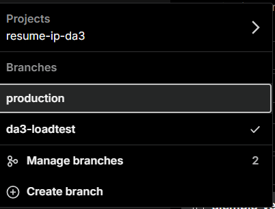

**Figure 1a.2. Pre-instrumentation health response retained as BEFORE evidence.**

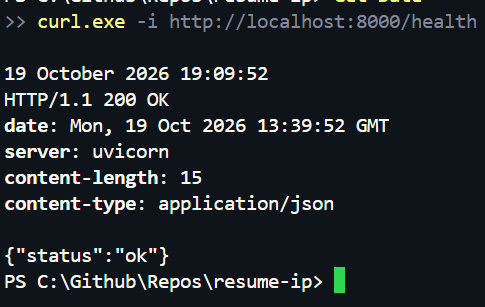

**Figure 1a.3. Instrumented health response includes `X-Served-By` and instance identity.**

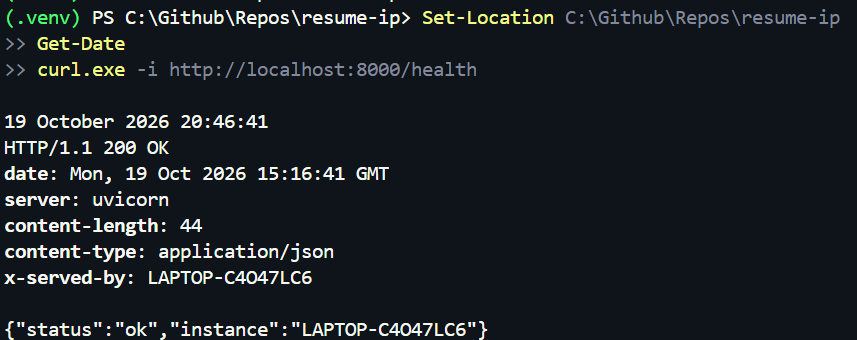

TODO(evidence): replace the seed-output capture with one that redacts the database host. The canonical `1a-xservedby-header.png` capture is present and indexed as captured.

**Figure 1a.4. The default isolated Compose topology has three healthy backend services and Nginx.**

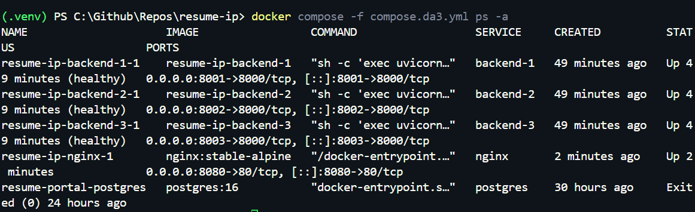

**Figure 1a.5. Twelve Nginx requests rotate exactly 4/4/4 across the backend identities.**

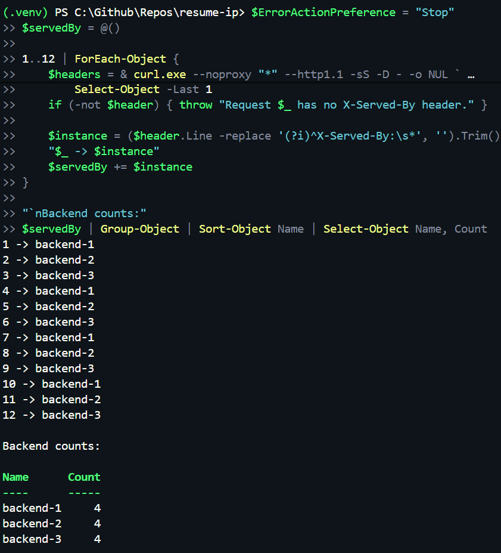

**Figure 1a.6. Docker reports the host resources and the configured backend limits.**

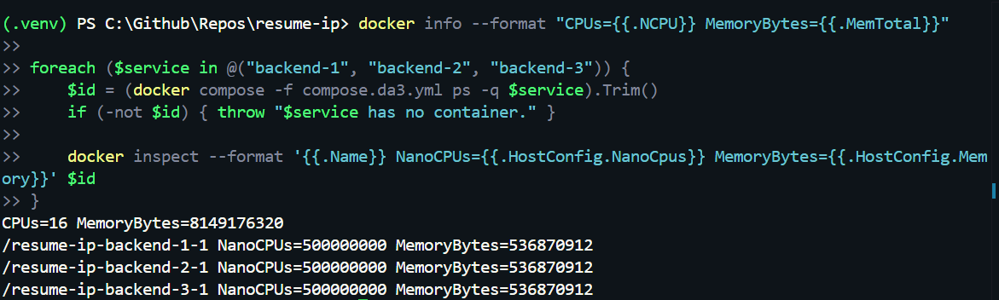

**Figure 1a.7. The Nginx-routed database health endpoint returns `db: ok`.**

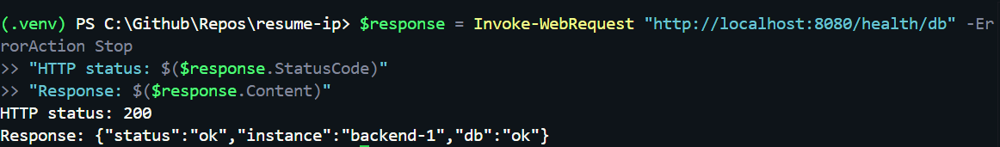

**Figure 1a.8. The authenticated 300-request distribution run passed, with independent header and final-upstream counts.**

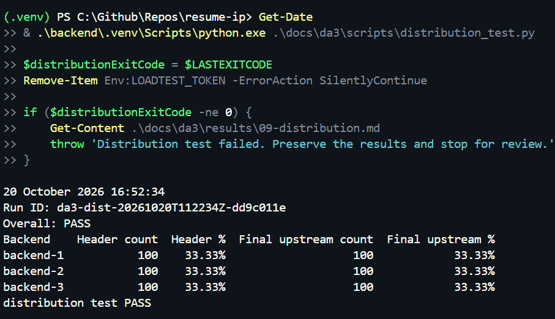

**Figure 1a.9. The Step 9 run's Nginx samples show the recorded upstream address-to-backend mapping.**

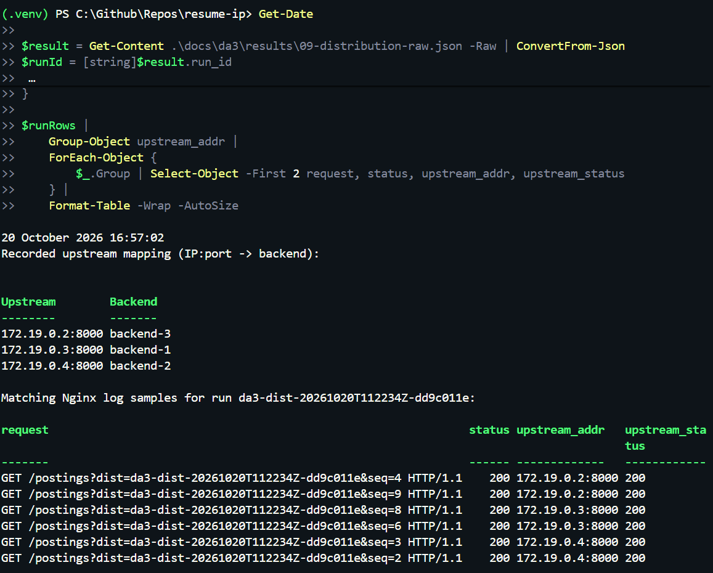

**Explanation:** The placement-drive assumptions describe a short read-heavy peak for this portal, where candidates repeatedly browse openings and check a submission after applying. The request-mix table is explicitly an input to the experiment, not a measurement of production traffic; actual arrivals may spike above the calculated 73.33 requests/s average, but that spike was not measured. For this measured run, the authenticated `GET /postings` requests reached all three Compose backends through Nginx, while `X-Served-By` and the independently mapped final `$upstream_addr` agreed per request and in aggregate.

**Honesty notes:** The scenario assumes submission and status-read traffic, but Step 7 does not replay the complete mix. The upload route uses GCS/Pub/Sub, and the upload/worker path remains outside the current experiment. This is one 300-request concurrency-10 distribution run, not the Step 10/11 1,000-request performance comparison or a production-load measurement.

## 1b — One versus three backend instances

**Requirement:** Using Apache Bench or any suitable free load-testing tool (for example, hey, JMeter or k6), send 1,000 requests to that API, first with 1 instance and then with 3 instances, keeping the same tool and concurrency level for both runs. Tabulate requests per second and average response time, and state the improvement. (1.5 marks)

**What I built:** A containerised Apache Bench harness in `docs/da3/scripts/loadtest.py` that uses the isolated Compose topology, runs a 100-request warm-up before each measurement, preserves raw output, and attempts to restore the three-backend topology after a run. The harness uses `ab -k` (HTTP Keep-Alive/persistent connections) against authenticated `GET /postings`. Each backend has one Uvicorn worker and the Compose configuration sets a `0.5` CPU limit per backend. Its effective SQLAlchemy pool values are size 5, overflow 5 and timeout 30 seconds.

**Commands run:**

```powershell
python docs/da3/scripts/loadtest.py --single-run --instances 1 --concurrency 20 --requests 1000 --rep 11
python docs/da3/scripts/loadtest.py --single-run --instances 3 --concurrency 20 --requests 1000 --rep 12
python docs/da3/scripts/loadtest.py --single-run --instances 1 --concurrency 50 --requests 1000 --rep 13
```

Authentication was refreshed through `docs/da3/scripts/get_token.py` before the validation runs; its token was held outside the saved artifacts.

The final Step 11 sequence used the same authenticated `GET /postings` route through Nginx, Apache Bench with `-k`, C20, 100 warm-up requests excluded from 1,000 measured requests, and three repetitions per topology in the locked interleaved order 1, 3, 1, 3, 1, 3. One fresh token was acquired for that sequence but is not present in the manifest or result artifacts.

**Result:** The formal calibration matrix is incomplete and no concurrency was selected by its original plateau rule. Table 1b.1 is the retained partial rep3 calibration, not a completed matrix or Step 11 benchmark.

| Configuration | C5 | C10 | C20 | C50 | C100 |
| --- | ---: | ---: | ---: | ---: | ---: |
| 1 backend, measured requests/s | 16.61 | 24.80 | 21.42 | warm-up failed | warm-up failed |
| 3 backends, measured requests/s | 15.78 | 32.41 | 50.14 | 66.82 | 64.68 |

*Table 1b.1. Partial calibration from `results/10-calibration-rep3.json`; the run is invalid/incomplete overall, so every cell was ineligible for formal selection.*

The owner later selected C20 after two separate successful 1,000-request validation runs:

| Validation | Warm-up | Measured | Failed / non-2xx | Requests/s | Mean response time | Restored three-backend topology |
| --- | ---: | ---: | ---: | ---: | ---: | --- |
| rep11: 1 backend, C20 | 100 | 1,000 | 0 / 0 | 9.97 | 2006.793 ms | true |
| rep12: 3 backends, C20 | 100 | 1,000 | 0 / 0 | 40.39 | 495.205 ms | true |

*Pre-benchmark C20 validation summary. Successful validations from `results/10-single-i1-c20-rep11.json` and `results/10-single-i3-c20-rep12.json`. Table 1b.2 remains reserved for the final three-repetition, interleaved Step 11 benchmark.*

| Run | Backends | Rep | Status | Requests/s | Mean time per request (ms) | Failed | Non-2xx | Median eligible | Measured raw output |
| ---: | ---: | ---: | --- | ---: | ---: | ---: | ---: | --- | --- |
| 1 | 1 | 1 | complete | 10.29 | 1943.935 | 0 | 0 | yes | `results/11-1b-s11-20261024t093248z-c7a71d7b-o1-i1-c20-r1.txt` |
| 2 | 3 | 1 | complete | 24.88 | 803.911 | 0 | 0 | yes | `results/11-1b-s11-20261024t093248z-c7a71d7b-o2-i3-c20-r1.txt` |
| 3 | 1 | 2 | complete | 8.52 | 2347.827 | 0 | 0 | yes | `results/11-1b-s11-20261024t093248z-c7a71d7b-o3-i1-c20-r2.txt` |
| 4 | 3 | 2 | complete | 22.25 | 898.935 | 0 | 0 | yes | `results/11-1b-s11-20261024t093248z-c7a71d7b-o4-i3-c20-r2.txt` |
| 5 | 1 | 3 | complete | 10.68 | 1872.073 | 0 | 0 | yes | `results/11-1b-s11-20261024t093248z-c7a71d7b-o5-i1-c20-r3.txt` |
| 6 | 3 | 3 | complete | 27.42 | 729.359 | 0 | 0 | yes | `results/11-1b-s11-20261024t093248z-c7a71d7b-o6-i3-c20-r3.txt` |

*Table 1b.2. Final Step 11 benchmark from `results/11-1b-manifest-s11-20261024t093248z-c7a71d7b.json` and `results/11-1b-summary.json`. The mean column is Apache Bench's first `Time per request` metric. All six saved harness results record successful activation/restoration and zero failed/non-2xx responses; each matched Nginx diagnostic records measured `200:1000`. Apache Bench omits a `Non-2xx responses` line when it is zero, so the saved harness result and the all-200 Nginx reconciliation retain that explicit zero.*

| Topology | Eligible runs | Median requests/s | Median mean time per request | Three-repetition state |
| --- | --- | ---: | ---: | --- |
| 1 backend | 3 of 3 | 10.29 | 1943.935 ms | complete |
| 3 backends | 3 of 3 | 24.88 | 803.911 ms | complete |

Throughput improvement = `(24.88 / 10.29 - 1) * 100` = **141.79%**. Throughput speedup = `24.88 / 10.29` = **2.418×**. Mean-response-time reduction = `(1 - 803.911 / 1943.935) * 100` = **58.65%**. Mean-response-time improvement factor = `1943.935 / 803.911` = **2.418×** (a value above one means lower mean response time with three backends).

**Evidence:** Figures 1b.1–1b.3 remain the historical calibration/validation captures. Figure 1b.4 shows a saved final one-backend Apache Bench result, Figure 1b.5 shows a saved final three-backend result, and Figure 1b.6 shows the aggregate table. `evidence/1b-docker-stats-1-instance.png` remains an idle historical capture and is not used as live-load evidence. `evidence/1b-docker-stats-live-load.png` shows the one-backend live-load capture; `evidence/1b-docker-stats-3-instances.png` shows the three-backend live-load capture. `results/11-1b-docker-stats-20261024-150227.log` is the retained sampler log.

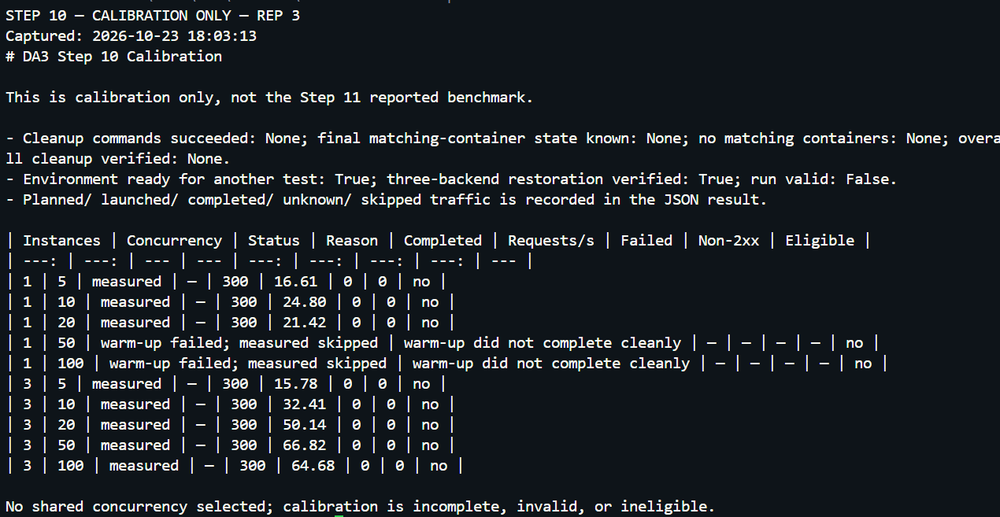

**Figure 1b.1. Partial, invalid/incomplete rep3 calibration table; it is not a Step 11 result.**

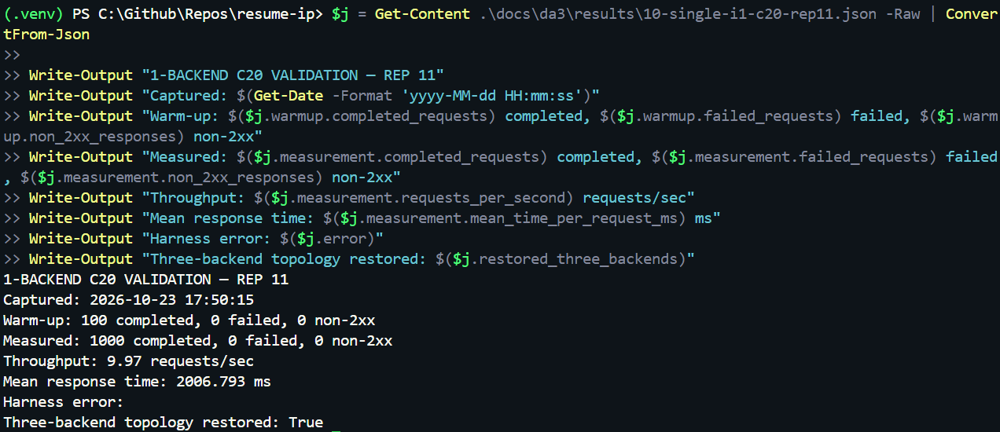

**Figure 1b.2. Screenshot of the saved rep11 one-backend C20 validation result.**

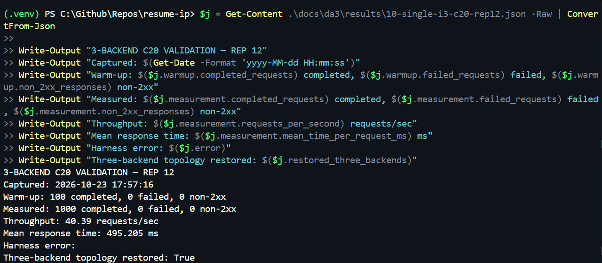

**Figure 1b.3. Screenshot of the saved rep12 three-backend C20 validation result.**

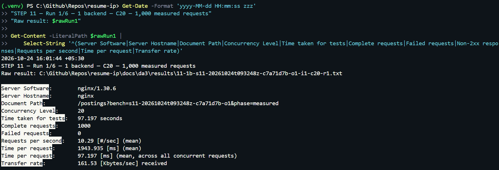

**Figure 1b.4. Final Step 11 run 1/6: one backend, C20, 1,000 measured requests.**

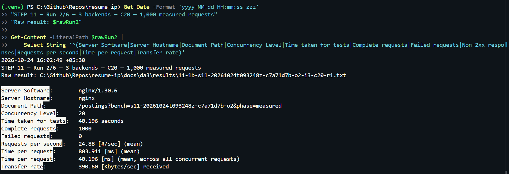

**Figure 1b.5. Final Step 11 run 2/6: three backends, C20, 1,000 measured requests.**

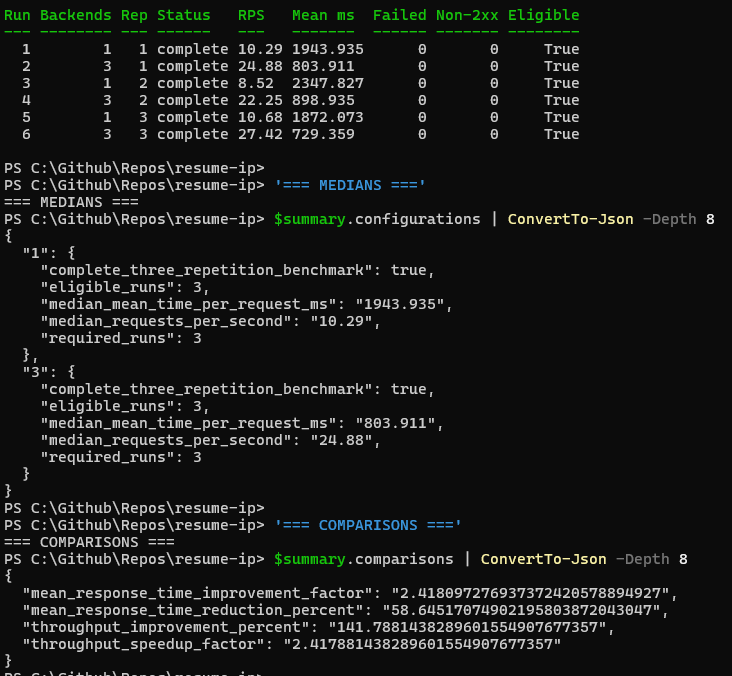

**Figure 1b.6. Final Step 11 six-run table, medians, and comparisons.**

**Explanation:** Adding two backend instances increased the measured median throughput from 10.29 to 24.88 requests per second (approximately 2.418×, or a 141.79% increase) and reduced median mean response time from 1,943.935 ms to 803.911 ms (approximately 58.65% lower). This is the observed result of this particular test, not proof that performance scales linearly with instance count. The backends share a request path through Nginx and the same external Neon database, so the database and shared infrastructure remain common dependencies. The formal Step 10 matrix remained incomplete, so C20 was owner-locked after the successful C20 validations rather than selected from a completed plateau calculation; C10 fallback was not triggered.

**Honesty notes:** The load generator and Nginx shared the test machine, so this was not an isolated distributed load-generator experiment. Each backend had a 0.5-CPU limit and one Uvicorn worker. All backends used the same remote Neon database, so network latency, database workload, and Neon compute behaviour can affect the result. Three repetitions per topology support observed medians only; they do not establish statistical significance or general performance guarantees. This Q1 measurement was taken before the planned hardening and MFA work and is not post-hardening/post-MFA performance. The Step 11 sequence planned 6,600 requests (six runs × 1,100); this is planned traffic, while the manifest records the actual completed warm-up and measured outcomes. Historical failed/incomplete calibration artifacts, including rep13's unknown measured sent/completed count, remain preserved separately and are not part of Table 1b.2.

## 1c — Backend failure resilience

**Requirement:** Stop one instance while the load test is running and record the failed requests. Then configure Nginx so that no request fails, and show the before-and-after count. (1.5 marks)

**What I built:** TODO(evidence)

**Commands run:** TODO(evidence)

**Result:** TODO(evidence)
TODO(evidence): availability-probe table.

**Evidence:** TODO(evidence)

**Explanation:** TODO(evidence)

**Honesty notes:** TODO(evidence)

## 1d — Architecture and cloud bursting/edge/fog

**Requirement:** Draw the architecture diagram of your own implementation, using the actual names of your components: your frontend, the three backend containers and Nginx from part (a) (with their ports), your cloud database and hosting platform from Assignment 1, and the tools used (e.g., MongoDB Atlas, Render, Firebase). Then add the cloud bursting or edge/fog computing component to the same diagram, marked in a different colour, and explain how it would handle your peak-demand situation from part (a), and why you chose it for your domain. (1 mark)

**What I built:** TODO(evidence)

**Commands run:** TODO(evidence)

**Result:** TODO(evidence)
TODO(evidence): components-and-ports table.

**Evidence:** TODO(evidence)

**Explanation:** TODO(evidence)

**Honesty notes:** TODO(evidence)

## 2a — Sensitive data and password hashing

**Requirement:** Identify the most sensitive data your application stores (for example, patient records, student marks, or employee/production data). Store user passwords as salted hashes (bcrypt or Argon2) instead of plain text, and show a database screenshot before and after. (1 mark)

**What I built:** Existing DA1 baseline: Argon2 password hashing exists in `backend/app/core/security.py`; this baseline implementation is not by itself DA3 evidence. TODO(evidence)

**Commands run:** TODO(evidence)

**Result:** TODO(evidence)
TODO(evidence): sensitive-data inventory table and hash/salt comparison table.

**Evidence:** TODO(evidence)

**Explanation:** TODO(evidence)

**Honesty notes:** TODO(evidence)

## 2b — MFA and update/delete authorization

**Requirement:** Add multi-factor authentication to login using a TOTP authenticator app (Google or Microsoft Authenticator). Restrict your Update and Delete APIs to logged-in users with the right role for your domain (for example, doctor, faculty, or supervisor), and show a request being rejected without a valid token. (1.5 marks)

**What I built:** Existing DA1 baseline: recruiter role and posting-owner checks exist for update/delete in `backend/app/routers/postings.py`; TOTP MFA has not yet been implemented. TODO(evidence)

**Commands run:** TODO(evidence)

**Result:** TODO(evidence)

**Evidence:** TODO(evidence)

**Explanation:** TODO(evidence)

**Honesty notes:** TODO(evidence)

## 2c — Trivy scan and image hardening

**Requirement:** Scan your application's Docker image with Trivy. Harden it (smaller base image, non-root user), rescan, and tabulate the CRITICAL and HIGH counts before and after. (1.5 marks)

**What I built:** Existing DA1 baseline: `backend/Dockerfile` uses a slim base and an unprivileged user; no DA3 baseline/rescan evidence has been collected yet. TODO(evidence)

**Commands run:** TODO(evidence)

**Result:** TODO(evidence)
TODO(evidence): CRITICAL/HIGH table rows for every scanned application image.

**Evidence:** TODO(evidence)

**Explanation:** TODO(evidence)

**Honesty notes:** TODO(evidence)

## 2d — Threat agents and regulation

**Requirement:** Name two threat agents relevant to your domain. For each, state the control you implemented against it and one requirement from the regulation that applies to your application (HIPAA for health data, GDPR for personal data in general), with a reason why that regulation applies. (1 mark)

**What I built:** TODO(evidence)

**Commands run:** TODO(evidence)

**Result:** TODO(evidence)

**Evidence:** TODO(evidence)

**Explanation:** TODO(evidence)

**Honesty notes:** TODO(evidence)

## Reproduction

TODO(evidence)

## Limitations and honesty notes

- The environment screenshots show the state observed on 18 October 2026; cloud service status can change.
- The Cloud Run service list and a loaded frontend page do not prove that all backend/database-dependent features work.
- The login screenshot establishes a generic UI failure only. It does not expose an HTTP status code or establish the exact exception.
- The Cloud SQL console explicitly reports the trial instance as suspended. Neon migration, table verification, and the synthetic 19/19 smoke test are recorded in Section 0; later scale and security work remains pending.
- All performance, failover and security-scan results remain pending until measured and captured.
- The DA3 experiments did not exercise the end-to-end resume upload and scoring path; the existing Google Cloud Storage and Pub/Sub code was left unchanged.

TODO(evidence)

## Evidence index

See [`04-evidence-index.md`](04-evidence-index.md). Phase 0 environment screenshots are embedded in Section 0 and listed in the evidence index. TODO(evidence)
